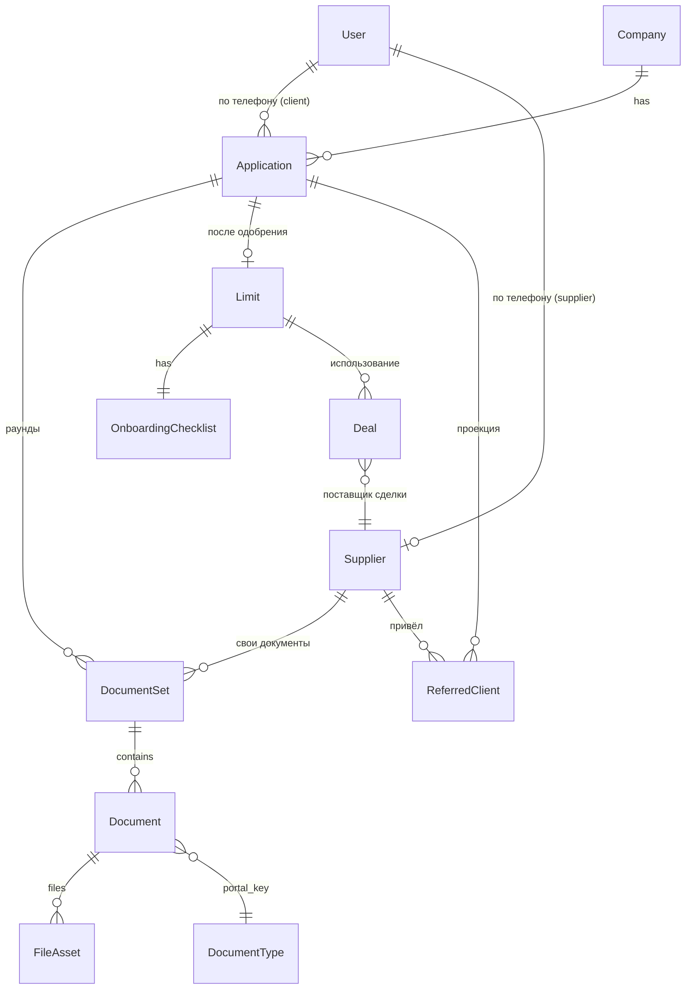

<!-- source: Drive 1_AzNT4yf-H-GRqfBEMLWUoXpSi1-1uY4, synced: 2026-11-11. Не редактировать — источник в Drive. -->
# 01 · Сущности и данные

**Проект:** Tadum · **Раздел:** Требования к продукту · **Версия:** 1.0 · **Дата:** 2026-11-04 · **Статус:** черновик на согласование
**Источники:** требования к кабинету клиента и поставщика, структура Drive (маппинг ассетов), решения D-010, D-012, D-013, D-017. **Связанные документы:** `01-roles.md`, `01-cabinet-structure.md`, `01-statuses.md`.

> Каждый YAML-блок переносится в `src/entities/<name>/model/types.ts` и в Zod-схему порта один в один. Колонка «Видимость» задаёт, что попадает в UI: `client`, `supplier`, `internal` (только для маппинга, в UI не выводится). Поля с пометкой `odoo:` — предполагаемый источник в Odoo для команды бэкенда; это гипотеза, её подтверждает `05-backend-contract.md`.

---

## 1. Карта сущностей



Принципы:

- **Набор документов задаёт Odoo, не портал.** `DocumentType` — открытый каталог; UI рендерит то, что пришло в `DocumentSet`, и не опирается на фиксированное число документов.
- **Статусы для UI вычисляются один раз** в слое `entities` из `odoo_stage` и никогда не пересчитываются в компонентах.
- **Деньги** — целые числа в халалах (1 SAR = 100) типа `Money = { amount_minor: number, currency: 'SAR' }`; форматирование — только через `shared/i18n/format.ts`.
- **Даты** — ISO 8601 строки в UTC; отображение — Asia/Riyadh, григорианский календарь.
- **Идентификаторы** — строки; в моке `app_…`, `doc_…`, `sup_…` для читаемости.

---

## 2. Сущности → код

### 2.1 User (сессия)

Описан в `01-roles.md`, раздел 1 (`Session`). Отдельной сущности «пользователь» с профилем нет.

### 2.2 Company

```yaml
Company:
  id: string                       # odoo: res.partner.id
  name: string                     # видимость: client (в шапке), supplier (в списке клиентов)
  name_ar?: string                 # если есть; иначе показываем name в обоих языках
  cr_number?: string               # Commercial Registration; видимость: client; формат 10 цифр, LTR
  # users[] намеренно отсутствует — один пользователь на компанию (D-010)
```

### 2.3 Application (заявка)

```yaml
Application:
  id: string                       # odoo: crm.lead.id
  company_id: string
  odoo_stage: OdooStage            # internal; см. 01-statuses.md §1
  client_status: ClientStatus      # вычисляется из odoo_stage; видимость: client
  permission_state: 'collecting' | 'reviewing' | 'active' | 'closed'   # вычисляется; 01-roles.md §4
  next_step: NextStep              # вычисляется; 01-cabinet-structure.md §6
  current_document_set_id: string  # активный раунд документов
  limit_id?: string                # появляется на Approved и дальше
  created_at: datetime             # дата заявки; видимость: client, supplier (в ReferredClient)
  updated_at: datetime
  source?: { supplier_id?: string, channel?: 'referral_link' | 'manual' | 'direct' }  # internal; нужно моку для ReferredClient
  review_eta_hours?: number        # если бэкенд отдаёт — подставляется в текст «займёт N часов»; иначе текст без срока
  collection_deadline_at?: datetime # 12 часов на базовый пакет; internal для мока (после — заявку берут продажи), в UI не показываем
```

### 2.4 DocumentSet (комплект документов, раунд)

```yaml
DocumentSet:
  id: string                       # odoo: набор строк Doc Collection Engine одного прохода
  owner: { kind: 'application' | 'supplier', id: string }
  round: number                    # 1 — первый сбор; 2+ — дозапросы (Need more docs for UW)
  status: DocumentSetStatus        # draft | submitted | in_review | completed | superseded; см. 01-statuses.md §4
  locked: boolean                  # true после отправки на проверку; редактирование запрещено
  submitted_at?: datetime
  completion_grace_until?: datetime # не используется (D-080); поле зарезервировано
  documents: Document[]            # порядок: rejected первыми, затем pending, затем received/approved
```

### 2.5 Document

```yaml
Document:
  id: string
  set_id: string
  portal_key: PortalKey            # см. §3
  status: DocumentStatus           # pending | received | rejected | approved; см. 01-statuses.md §5
  required: boolean                # обязательный в этом комплекте (задаёт Odoo)
  reject_reason_key?: string       # ключ согласованного клиентского текста тега UW; свободный текст не передаётся
  reject_reason_text?: { ar: string, en?: string }   # текст тега, если бэкенд отдаёт готовые строки; en может отсутствовать → нейтральный текст в EN
  rejected_file_hashes: string[]   # хэши файлов, которые уже отклоняли (TADUM-536)
  files: FileAsset[]
  hint: DocumentHint               # подсказка/пример/видео из каталога типов
  updated_at: datetime
```

### 2.6 FileAsset

```yaml
FileAsset:
  id: string
  name: string                     # имя файла как загрузил пользователь
  mime: 'application/pdf' | 'image/jpeg' | 'image/png'
  size_bytes: number               # ≤ 10 * 1024 * 1024
  sha256: string                   # для проверки повторной загрузки отклонённого файла
  uploaded_at: datetime
  download_url: string             # прямая ссылка с Content-Disposition (ограничения WhatsApp IAB)
  prevalidation: PrevalidationResult
UploadProgress:                    # только клиентское состояние, не хранится
  file_id?: string
  percent: number                  # 0..100
  state: 'queued' | 'uploading' | 'validating' | 'done' | 'failed'
  error_key?: string
PrevalidationResult:
  state: 'passed' | 'warning' | 'failed' | 'skipped'
  rule_keys: string[]              # например prevalidation.bs.period_too_short; тексты — из i18n
```

### 2.7 Limit

```yaml
Limit:
  id: string                       # odoo: лимит, связанный с application_lead_id
  application_id: string
  status: LimitStatus              # pending | ready | active | cancelled | rejected
  approved: Money                  # одобренный лимит
  used: Money                      # сумма непогашенных сделок; вычисляется
  available: Money                 # approved − used; вычисляется, не меньше 0
  # term_months намеренно отсутствует: срок с продажами клиенту в MVP не показываем (D-036); вернуть в фазе 2
  checklist: OnboardingChecklist
  activated_at?: datetime
```

### 2.8 OnboardingChecklist

```yaml
OnboardingChecklist:
  items:
    - key: 'spa_sadq'              # подписание SPA в Sadq
      status: ChecklistItemStatus  # pending | in_progress | done | failed
      external_url?: string        # ссылка с кодом; третьи стороны называем только текстом, без логотипов
    - key: 'pn_company_nafith'     # вексель компании в Nafith
      status: ChecklistItemStatus
      external_url?: string
    - key: 'pn_owner_nafith'       # вексель владельца в Nafith
      status: ChecklistItemStatus
      external_url?: string
  completed: boolean               # все три done
```

### 2.9 Deal (минимум для расчётов)

Сделки вне MVP как раздел, но нужны для `Limit.used` и `ReferredClient.turnover_sar`.

```yaml
Deal:
  id: string
  application_id: string
  supplier_id: string
  amount: Money
  stage: 'quotation' | 'approved' | 'payment_done' | 'repaid' | 'cancelled'   # internal
  outstanding: Money               # непогашенный остаток; для Limit.used
  paid_at?: datetime
# Правила (D-012): в turnover поставщика входят сделки со stage ∈ {payment_done, repaid};
# в Limit.used — сделки с outstanding > 0.
```

### 2.10 Supplier

```yaml
Supplier:
  id: string                       # odoo: tadum.supplier.id
  name: string
  slug: string                     # реферальная страница tadum.sa/s/{slug}; редактировать нельзя (SFL-850)
  referral_url: string             # https://tadum.sa/s/{slug}
  supplier_status: SupplierStatus  # docs_required | under_review | active; см. 01-statuses.md §3
  next_step: NextStep
  current_document_set_id: string
  counters:
    referred_total: number         # все привязанные лиды
    under_review: number           # по supplier_view_status == under_review
    approved: number               # approved + first_purchase
  phones: string[]                 # нормализованные (D-013); internal
```

### 2.11 ReferredClient (проекция заявки для поставщика)

```yaml
ReferredClient:
  application_id: string
  company_name: string
  applied_at: datetime
  supplier_view_status: SupplierViewStatus   # applied | collecting_docs | under_review | approved | first_purchase | closed
  turnover: Money                  # сумма сделок этого клиента, где поставщик = этот; только payment_done и дальше (D-012)
  updated_at: datetime             # дата последнего изменения статуса
  attribution: 'referral_link' | 'manual'    # по ссылке или привязан командой вручную; internal, в UI не выводим
  # Намеренно отсутствуют: телефон клиента, одобренный лимит, причина закрытия, другие поставщики
```

Фильтр: по `supplier_view_status` (мультивыбор). Сортировка: по `applied_at` и `updated_at`, по умолчанию `applied_at desc`. Если клиента привели два поставщика — он виден обоим, у каждого свой `turnover`.

### 2.12 OfferContent (условия и материалы Tadum)

```yaml
OfferContent:
  terms: { ar: RichText, en: RichText }      # один текст для всех поставщиков
  materials:
    - id: string
      title: { ar: string, en: string }
      kind: 'pdf' | 'video'
      lang: 'ar' | 'en' | 'both'
      download_url: string         # прямая ссылка; событие material_downloaded {id, lang}
      size_bytes?: number
```

---

## 3. Каталог типов документов (`DocumentType`) → код

Каталог **открыт для расширения**: новые `portal_key` добавляются без правок UI (нужен только ключ i18n и, при наличии, ассеты). Список ниже — то, что известно на 2026-11-04.

| `portal_key` | Документ | Кому | Пример PDF (Assets/templates) | Видео AR (Assets/uploads) | Видео EN | Примечание |
|---|---|---|---|---|---|---|
| `bs` | Банковская выписка | client | Bank Statement Template.pdf | Arabic Bank Statement.mp4 | — | предвалидация: период, владелец счёта |
| `national_id` | Удостоверение личности владельца | client | Owner National ID Template.pdf | Arabic ID.mp4 | — | |
| `vat` | Сертификат VAT | client | VAT Certificate Template.pdf | Arabic VAT cert.mp4 | — | по требованиям может быть выведен из обязательных — `required` решает Odoo |
| `vat_sales` | Декларации VAT | client | VAT Filling Template.pdf | Arabic Filed VAT Return.mp4 | — | |
| `ch_owner` | Кредитный отчёт владельца (Molim) | client | MOLIM Owner Credit Report Template.pdf | Arabic MOLIM.mp4 | — | |
| `ch_company` | Кредитный отчёт компании (SIMAH) | client | SIMAH Credit Report Template.pdf | Arabic SIMAH.mp4 | — | может быть выведен из обязательных |
| `aoa` | Устав компании | client | — | — | — | состояние «без примера и видео» (D-017) |
| `sup_vat` | Сертификат VAT поставщика | supplier | — | — | — | тот же документ, что `vat`, но отдельный ключ: другой комплект и другие подсказки |
| `sup_iban_letter` | Письмо IBAN | supplier | — | — | — | |
| `sup_national_address` | Национальный адрес | supplier | — | — | — | у клиента уже убран из обязательных |
| `sup_cr` | Коммерческая регистрация (CR) | supplier | — | — | — | «при необходимости» — `required` решает Odoo |

```yaml
# → код: src/entities/document/model/catalog.ts
DocumentType:
  portal_key: PortalKey
  audience: 'client' | 'supplier'
  title_key: string                # i18n: document.<portal_key>.title
  hint_key: string                 # i18n: document.<portal_key>.hint (короткая подсказка «что это и где взять»)
  example_pdf_url?: string         # из Assets/templates; отсутствует → состояние без примера
  video_url?: { ar?: string, en?: string }   # из Assets/uploads; en пока нигде нет (D-017)
  accepted_mime: ['application/pdf', 'image/jpeg', 'image/png']
  max_size_bytes: 10485760
  prevalidation_rules: string[]    # ключи правил; реализация — имитация в моке
DocumentHint:                      # то, что реально показываем в карточке документа
  title_key, hint_key, example_pdf_url?, video_url?
```

Маппинг файлов на ключи выведен из названий и ждёт подтверждения (вопрос В16 в плане). Обязательность (`required`) и состав комплекта **всегда** приходят из `DocumentSet`, не из каталога.

---

## 4. Enum-типы (единый источник)

Значения перечислений определяются в `01-statuses.md`; здесь — сводка имён, чтобы ссылки в коде были однозначны.

| Тип | Значения | Где определён |
|---|---|---|
| `OdooStage` | New lead, Processing lead, Document collection, Need more docs for UW, Ready for UW, Company risk assessment, Risk committee, Approved, Offer confirmation, Signing SPA & PN, Client Approved, Payment done, Rejected by UW, Lost | `01-statuses.md` §1 |
| `ClientStatus` | `docs_required`, `under_review`, `approved`, `first_purchase`, `closed` | §2 |
| `SupplierViewStatus` | `applied`, `collecting_docs`, `under_review`, `approved`, `first_purchase`, `closed` | §2 |
| `SupplierStatus` | `docs_required`, `under_review`, `active` | §3 |
| `DocumentSetStatus` | `draft`, `submitted`, `in_review`, `completed`, `superseded` | §4 |
| `DocumentStatus` | `pending`, `received`, `rejected`, `approved` | §5 |
| `LimitStatus` | `pending`, `ready`, `active`, `cancelled`, `rejected` | §6 |
| `ChecklistItemStatus` | `pending`, `in_progress`, `done`, `failed` | §7 |
| `PortalKey` | см. §3 этого документа (открытый список) | здесь |

---

## 5. Видимость полей по ролям (сводка для ревью)

| Сущность | client видит | supplier видит | никто не видит (internal) |
|---|---|---|---|
| Application | `client_status`, `next_step`, `created_at`, комплект, лимит | только через `ReferredClient` | `odoo_stage`, `source`, `collection_deadline_at` |
| Document | всё, кроме internal | свои документы — всё | `rejected_file_hashes` (используется только для проверки) |
| Limit | approved / used / available, статус, чек-лист | — | — |
| Supplier | — | всё, кроме `phones` | `phones` |
| ReferredClient | — | `company_name`, `applied_at`, `supplier_view_status`, `turnover`, `updated_at` | `attribution`, телефон, лимит, причина закрытия |
| Deal | — (раздел вне MVP) | — (только агрегат `turnover`) | всё |

---

## 6. Персоны для мока и демо-режима

Фикстуры в `shared/api/fixtures/personas/*.ts`; идентификатор персоны = значение `?persona=`. Каждая персона — полный согласованный граф данных.

| `persona_id` | Роли | Состояние | Для каких сценариев |
|---|---|---|---|
| `client_new` | client_contact | `docs_required`, раунд 1, ничего не загружено | SC-01, SC-02 |
| `client_partial` | client_contact | `docs_required`, часть документов `received`, часть `pending`, есть предупреждение предвалидации | SC-02 |
| `client_rejected` | client_owner | `docs_required`, 2 документа `rejected` (один с текстом причины AR+EN, один с причиной только AR, один без причины), один файл уже отклонялся | SC-03 |
| `client_submitted` | client_contact | `under_review`, комплект `locked`, `review_eta_hours = 24` | SC-05 |
| `client_more_docs` | client_contact | `docs_required`, раунд 2, новый комплект из 2 документов, старый `superseded` | SC-04 |
| `client_approved_unsigned` | client_owner | `approved`, лимит `ready`, чек-лист: все пункты `pending` | SC-06 |
| `client_offer_pending` | client_owner | `approved`, лимит `pending` (Offer confirmation), чек-лист неактивен | SC-06 |
| `client_signing_partial` | client_owner | `approved`, лимит `ready`, SPA `done`, вексель компании `in_progress`, вексель владельца `pending` | SC-06 |
| `client_limit_cancelled` | client_owner | `approved`, лимит `cancelled` | SC-06 A7 |
| `client_active` | client_owner | `approved`, лимит `active` 150 000 SAR, использовано 42 500 | SC-06, SC-07 |
| `client_first_purchase` | client_owner | `first_purchase`, одна сделка `payment_done` | SC-06, SC-07 |
| `client_closed_rejected` | client_contact | `closed` (Rejected by UW), лимит `rejected` | SC-08 |
| `client_closed_lost` | client_contact | `closed` (Lost) | SC-08 |
| `supplier_new` | supplier | `docs_required`, 0 клиентов | SP-01, SP-03 |
| `supplier_active` | supplier | `active`, 14 приведённых клиентов во всех статусах, обороты | SP-02, SP-04, SP-05 |
| `unknown_phone` | — | номер без заявки | SC-01 (ошибка) |

Правила генерации: `faker` с фиксированным `seed` на персону; названия компаний — вымышленные, арабские и английские варианты; телефоны только вида `+966 5X XXX XXXX` из диапазона, не принадлежащего реальным номерам (`+966 50 000 0XXX`); суммы кратны 500 SAR; даты относительно «сегодня», чтобы персоны не устаревали.

---

## 7. Открытые вопросы

Решено (2026-11-04): E-2 — `term_months` в UI не показываем, поле убрано до фазы 2 (D-036).

| # | Вопрос | По умолчанию до ответа | Владелец |
|---|---|---|---|
| E-1 | Отдаёт ли бэкенд готовый текст причины отказа (`reject_reason_text`) или только ключ тега (`reject_reason_key`)? | Поддерживаем оба; приоритет у текста, если он есть | Бэкенд |
| E-3 | `sup_vat` — отдельный ключ или переиспользовать `vat`? | Отдельный ключ (разные комплекты и подсказки) | Бэкенд / Ops |
| E-4 | Для `ReferredClient.updated_at` — дата любого изменения лида или только смены статуса? | Только смены статуса | Продукт |
| E-5 | Валюта `Money` жёстко SAR или оставить поле? | Поле остаётся, значение всегда `SAR` | Разработка |
